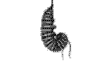

# P5.js: Image Morph

[Deutsch](README_DE.md)

Morphs one bitmap into another. A morph is more than a fade: matching
features travel from one image to the other (the warp) while the pixels
cross-blend (the dissolve). The example turns a caterpillar (`2.png`) into
a cocoon (`1.png`), rendered as dithered 1-bit black and white; a slider
scrubs between the two.

## Installation

Requirements: a browser and an internet connection (p5.js is loaded from a
CDN). The sketch reads image pixels, which only works over HTTP – opening
`index.html` directly from `file://` does not work.

1. Open the folder in Visual Studio Code and start Live Server (click
   **Go Live** in the status bar). Any static server works too, e.g.
   `python3 -m http.server` and then `http://localhost:8000`.
2. Drag the slider below the image.

Libraries: p5.js 1.9.4 (from jsDelivr, linked in `index.html`).

## Coding Help

| File         | Role                                                          |
|--------------|---------------------------------------------------------------|
| `index.html` | Loads p5.js (from CDN), then `morph.js` and `sketch.js`.      |
| `morph.js`   | The morph engine: triangulation, warp, sampling, dithering.   |
| `sketch.js`  | Loads the images, sets up the slider, draws the morph.        |
| `1.png`      | Image B – cocoon (224 × 128).                                 |
| `2.png`      | Image A – caterpillar (224 × 128).                            |

- **`sketch.js` → `ptsA` / `ptsB`**: the feature points in image pixels
  (0…223 × 0…127). `ptsA[i]` on image A marks the same feature as
  `ptsB[i]` on image B. Keep both arrays the same length and list only
  interior points; the four corners are added automatically.
- **`preload()` / `IMG_W` / `IMG_H`**: the two images and their size. For
  other images change the filenames, update the size and re-place the
  feature points.
- **`setup()` / `draw()`**: create the canvas, the `Morph` and the slider.
  The morph is expensive, so `noLoop()` is set and `draw()` only runs when
  the slider moves; it passes the slider value to `morph.setAmount()` and
  draws `morph.render()`.
- **`morph.js` → `delaunay()`**: Delaunay triangulation
  ([Bowyer–Watson](https://en.wikipedia.org/wiki/Bowyer%E2%80%93Watson_algorithm))
  without an external library. `Morph.retriangulate()` triangulates the
  midpoints of the A/B pairs, so all point sets share one topology.
- **`Morph.render()` / `_rasterize()`**: interpolates every feature point
  from A to B by the morph amount `t`. For every pixel of each in-between
  triangle, [barycentric coordinates](https://en.wikipedia.org/wiki/Barycentric_coordinate_system)
  locate the matching spot in triangle A and B; both images are sampled
  there (`sampleLuma()`, bilinear) and blended by `t`.
- **`floydSteinberg()`**: reduces the grayscale result to black and white
  with error diffusion, for the stippled look.
